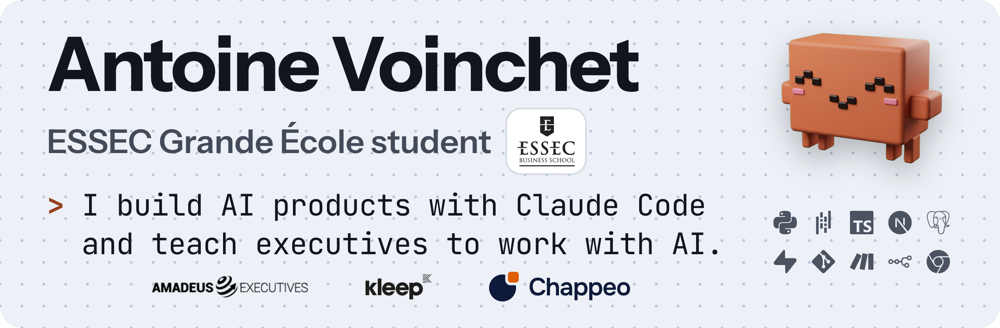

<picture>
  <source media="(prefers-color-scheme: dark)" srcset="banner/banner-dark.png">
  
</picture>

**Looking for:** a 6-month internship from January 2027, in Paris, in AI transformation, strategy consulting or AI product roles.

ESSEC Grande École (Master in Management). Before that: co-founder of Polaris IA, an AI process-automation consultancy (2025), then chief of staff to the CEO and customer success manager at Kleep, an AI fashion-tech company (2025–2026). Since October 2026 I have been designing and teaching an AI course for interim executives at Amadeus Executives.

I don't write code by hand: I design, scope and verify the work, and Claude Code writes it. What I bring is method: success criteria set before the data, tests, independent review, and human approval before anything irreversible.

## Selected projects

| Project | What it is | Result |
|---|---|---|
| [capture-chrome-extension](https://github.com/antoinevoinchet-spec/capture-chrome-extension) | Chrome extension that captures a full web page, then annotates and exports it | 758 automated checks (4 Nov 2026); every batch reviewed by an independent agent |
| [news-alpha](https://github.com/antoinevoinchet-spec/news-alpha) | Can an AI model reading 16,432 filings from US-listed companies beat the Russell 2000? | Criteria frozen in advance. **No-go** for that model and prompt over that period |
| [cockpit](https://github.com/antoinevoinchet-spec/cockpit) | Monitoring panel for AI agents: activity, usage, code changes without tests | Audited, then improved in seven workstreams, each independently reviewed |
| [prompt-forge](https://github.com/antoinevoinchet-spec/prompt-forge) | Prompt-writing skill (MIT), adapted and extended from an open-source project | Measured on 17 scenarios, 90% of them checked by code |

**Also built, code private**

- [Chappeo](https://chappeo.fr): helps accounting firms move their small-business clients onto e-invoicing. Website live since September 2026; a published study of 85 Paris-region accounting firms' websites (58 say nothing about e-invoicing, none shows a price); diagnostic tool covered by 105 test cases.
- Bourse Opportunités: quantitative equity research. A Quality-Value backtest on European equities dropped after failing its pre-registered test, and four strategies rejected against pre-declared thresholds; data pipeline with 1,098 Python tests.
- AI course for interim executives (Amadeus Executives): six one-hour sessions for 20 to 25 participants each, under way; course website launched in 3 days.

## How I work

- **Criteria before data.** Success thresholds are written down before any result is seen, and applied as written, including when the answer is no.
- **Tests, then a fresh pair of eyes.** Work is tested, then reviewed by an independent agent that did not write it, before I sign it off.
- **Guardrails on agents.** I designed a guardrail where irreversible actions (push, deletion, destructive SQL, production deployment, paid API calls) are blocked or wait for human approval. Prototype validated over 104 runs, on a fictional project.

## Tools and contact

Claude Code with Python (pandas), TypeScript/Next.js, SQL/PostgreSQL, Supabase and Git; Make and n8n for no-code automation.

[antoine.voinchet@essec.edu](mailto:antoine.voinchet@essec.edu) · [LinkedIn](https://www.linkedin.com/in/antoine-voinchet/) · French (native), English (C1), Spanish (B2)
